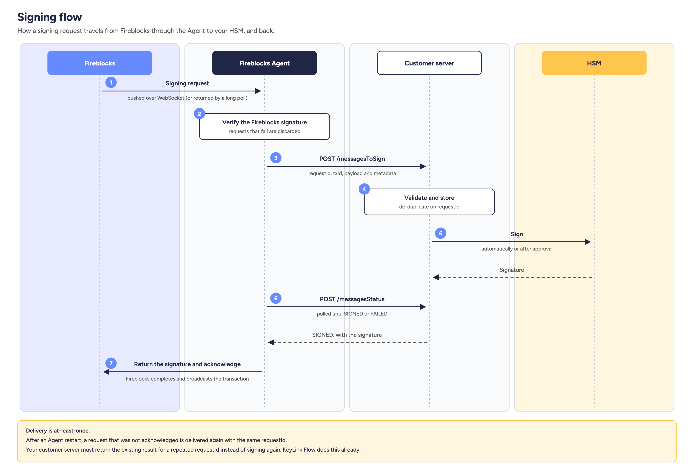
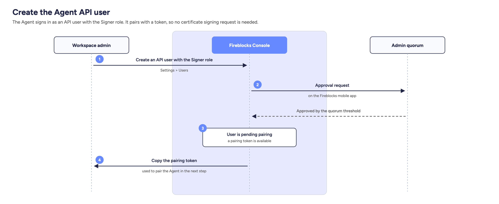
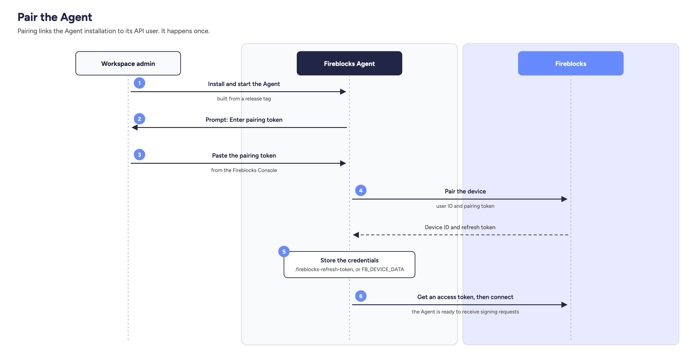
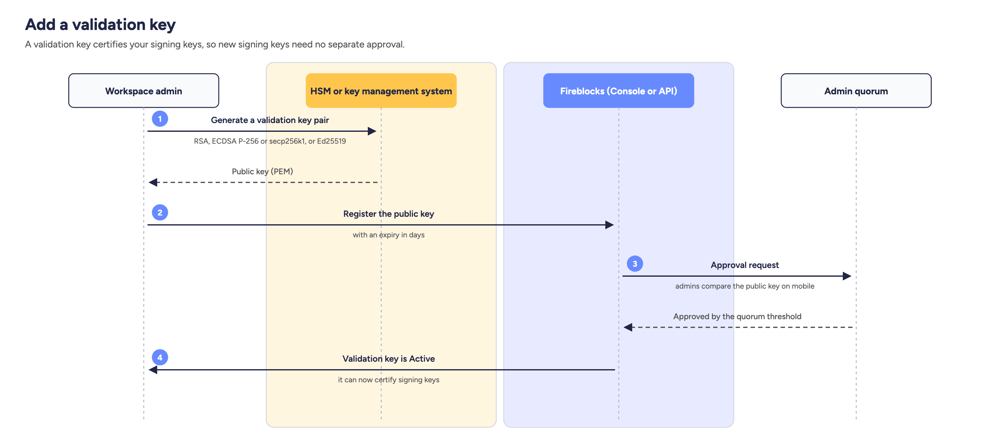
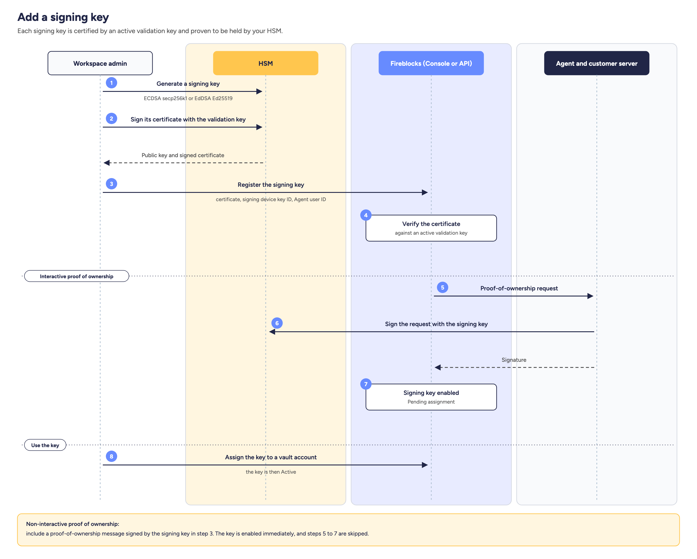

[](https://github.com/fireblocks/fireblocks-agent/actions/workflows/node.js.yml)


# Fireblocks Agent

The Fireblocks Agent connects your Fireblocks Key Link workspace to the system that holds your keys. It receives signing requests from Fireblocks, forwards them to your Customer Server, and returns the signed results to Fireblocks.

> **This is source-available software, not open source.** The source is published so that customers can install, run and audit it, but it remains Fireblocks' proprietary software. Use is governed by the [Fireblocks Key Link Agent Licence](LICENSE.md). See [Licence](#licence) below.

## Contents

1. [What the Agent is](#what-the-agent-is)
2. [KeyLink Flow](#keylink-flow)
3. [Requirements](#requirements)
4. [Production deployment](#production-deployment)
5. [Configuration](#configuration)
6. [Message delivery and reliability](#message-delivery-and-reliability)
7. [Transport modes](#transport-modes)
8. [Customer Server contract](#customer-server-contract)
9. [Operations](#operations)
10. [Troubleshooting](#troubleshooting)
11. [Develop locally](#develop-locally)
12. [Reporting a security issue](#reporting-a-security-issue)
13. [Licence](#licence)

# What the Agent is

The Agent is a lightweight relay that you run on your own infrastructure.

- **It holds no keys and does no signing.** Signing happens in your Customer Server, backed by your HSM or key management system.
- **It verifies every request before forwarding it.** The Agent checks the Fireblocks signatures on each request against the Fireblocks service certificates. A request that fails verification is discarded and never reaches your Customer Server.
- **It connects outbound only.** The Agent opens connections to Fireblocks and to your Customer Server. It listens on no port and exposes no API of its own.

```
Fireblocks (Mobile API Gateway)  <--- outbound HTTPS / WSS ---  Fireblocks Agent  --- HTTP(S) --->  Customer Server  --->  HSM
```

The Customer Server is one of the following:

- **KeyLink Flow**, the customer-hosted key management and signing orchestration service that Fireblocks provides as a companion to Key Link. See [KeyLink Flow](#keylink-flow).
- **Your own server**, built against the [Customer Server API](api/customer-server.api.yml). See [Customer Server contract](#customer-server-contract).



The diagram shows the default WebSocket transport, where Fireblocks pushes requests to the Agent. With HTTP long-polling, the Agent retrieves them instead; the rest of the flow is the same. See [Transport modes](#transport-modes).

### Actors

| Actor | Role |
| --- | --- |
| Console | The Fireblocks web console. |
| Mobile API Gateway | The Fireblocks endpoint the Agent connects to, for pairing and for receiving and answering requests. |
| Developer API | The Fireblocks API used for workspace setup and configuration. |
| Fireblocks Agent | This service. Relays requests between Fireblocks and your Customer Server. |
| Customer Server | Your server, or KeyLink Flow. Signs requests through your HSM. |
| HSM | Your HSM or key management system, on premises or in the cloud. |

# KeyLink Flow

KeyLink Flow is the companion to Fireblocks Key Link: a customer-hosted key management and signing orchestration service that connects your HSM to Fireblocks, in hot or air-gapped cold mode, so you deploy the integration instead of building it. It runs in your own environment, with a web console, and acts as your Customer Server: instead of building and maintaining your own server against the [Customer Server API](api/customer-server.api.yml), you deploy KeyLink Flow next to the Agent and connect it to your HSM.

What KeyLink Flow provides:

- **Hot mode:** one server, connected to the Agent and to your HSM, signs requests as they arrive or after an operator approves them.
- **Cold mode:** an online server receives requests and an air-gapped offline server signs them with your HSM. Requests and signatures move between the two as files, so the offline server and your HSM have no connection to Fireblocks or the online environment.
- **Key management:** create and manage your validation and signing keys in your HSM, ready to register with Fireblocks. On Thales Luna HSMs, derive signing keys from master keys to scale to large numbers of keys.
- **HSM support:** works with any HSM that supports the PKCS#11 interface, with ready-made configurations for Thales Luna.
- **Operator console:** a web console to monitor and approve signing requests and manage keys.
- **Business continuity:** in Hot mode, sign and broadcast transactions when Fireblocks is unreachable.

KeyLink Flow is available to Fireblocks Key Link customers. To get access, contact your Customer Success Manager (CSM).

# Requirements

| Requirement | Detail |
| --- | --- |
| Container runtime | Docker or any runtime that runs a standard image. The [Dockerfile](Dockerfile) builds on `node:24.22.1-alpine`. |
| Node.js (source runs only) | Node.js 24.22.1, as pinned in [.nvmrc](.nvmrc). Needed only if you run the Agent outside the container. |
| Outbound to Fireblocks | HTTPS and WebSocket Secure (WSS) on port 443 to `MOBILE_GATEWAY_URL`. In production this is `https://mobile-api.fireblocks.io`. |
| Outbound to your Customer Server | HTTP or HTTPS to `CUSTOMER_SERVER_URL`. |
| Inbound | None. Open no inbound ports for the Agent. |
| Fireblocks setup | A Key Link workspace and an Agent API user with a pairing token. See [Workspace setup flows](#workspace-setup-flows). |

# Production deployment

## 1. Build the image from a release tag

Always deploy a tagged release, never a branch.

```bash
git clone https://github.com/fireblocks/fireblocks-agent.git
cd fireblocks-agent
git checkout <release-tag>            # for example 2.4.3
docker build -t fireblocks-agent:<release-tag> .
```

What the image does, as defined in the [Dockerfile](Dockerfile):

- Starts from `node:24.22.1-alpine` and works in `/app`.
- Copies `.env.prod`, `src` and `api`, runs `npm install` and `npm run build`.
- Installs `pm2` globally and starts the Agent with `pm2 start dist/index.js && pm2 attach 0`. `pm2` restarts the Agent process if it exits.
- Sets no `USER`, so the container runs as root unless you override it.
- Exposes no ports and defines no health check.

## 2. Pair the Agent once

Pairing exchanges a one-time pairing token for the Agent's device credentials: a JSON document with `userId`, `deviceId` and `refreshToken`. Pair once, then reuse the credentials for every later start.

1. Create the Agent API user and get its pairing token. See [Workspace setup flows](#workspace-setup-flows).
2. Start a temporary container with an interactive terminal. Run the Agent directly with `node` rather than through `pm2`, so the pairing prompt is attached to your terminal:

   ```bash
   docker run -it --name fireblocks-agent-pairing -e NODE_ENV=prod fireblocks-agent:<release-tag> node dist/index.js
   ```

3. At the `Enter pairing token` prompt, paste the pairing token. Wait for `Great! your device is now paired!`.
4. In a second terminal, copy the credentials file out of the container, then remove the container:

   ```bash
   docker cp fireblocks-agent-pairing:/app/dist/.fireblocks-refresh-token ./device-data.json
   docker rm -f fireblocks-agent-pairing
   ```

5. Store the contents of `device-data.json` in your secrets manager (for example HashiCorp Vault, AWS Secrets Manager or Google Secret Manager). Then delete the local file.

The credentials file is a bearer credential: anyone who holds it can act as your Agent. The refresh token does not rotate, so the stored value stays valid across restarts and upgrades.

## 3. Run the Agent with `FB_DEVICE_DATA`

Inject the stored credentials as the `FB_DEVICE_DATA` environment variable from your secrets manager. The Agent then starts already paired, with no prompt and nothing written to disk. It logs only that it used the variable, never its value.

```bash
# FB_DEVICE_DATA is already in the shell environment, loaded from your secrets manager.
docker run -d --name fireblocks-agent \
  --restart unless-stopped \
  -e NODE_ENV=prod \
  -e CUSTOMER_SERVER_URL=https://customer-server.example.internal/api \
  -e CUSTOMER_SERVER_AUTHORIZATION \
  -e FB_DEVICE_DATA \
  fireblocks-agent:<release-tag>
```

- **Never put `FB_DEVICE_DATA` in a committed `.env` file or on a command line.** Pass it by name, as above, or through your orchestrator's secret mechanism (for example a Kubernetes Secret synced from your secrets manager).
- **Set `CUSTOMER_SERVER_URL`.** The shipped `.env.prod` points it at `http://localhost:5000/api`, which inside a container is the container itself.
- **Set a restart policy** (`--restart unless-stopped`, or `restartPolicy: Always` in Kubernetes), so the container comes back if it stops.
- **Watch the logs, not only the container state.** The [Dockerfile](Dockerfile) runs the Agent under `pm2`, which restarts the Agent process whenever it exits: on an uncaught error, or at startup if it is not paired and has no interactive terminal. The container keeps running and looks healthy to Docker or Kubernetes, and the reason appears only in the container log (`docker logs`), so include that log in your monitoring.
- **Run as a non-root user where your platform controls it.** The image does not set one. If you set one (for example with `docker run --user` or a Kubernetes `securityContext`), that user needs write access to `/app` (the Agent writes its log files to its working directory) and to its home directory (`pm2` keeps its state there).

## Workspace setup flows

These flows happen once, in your Fireblocks workspace and your HSM. Only pairing involves the Agent.

### Create the Agent API user



### Pair the Agent device



### Add a validation key

You add a validation key once. Fireblocks uses it to approve new signing keys. You add it through the Fireblocks API, not through the Agent.



### Add signing keys

Convert each signing key into a certificate signed by an active validation key. Then register the signed certificates with Fireblocks through the API or the Console.



# Configuration

The Agent reads its configuration from environment variables. It also loads the file `.env.<NODE_ENV>` from the project root, for example `.env.prod` when `NODE_ENV=prod`. A variable already set in the environment takes precedence over the same variable in the file.

### Connection

| Variable | Default | Description |
| --- | --- | --- |
| `MOBILE_GATEWAY_URL` | None (`.env.prod`: `https://mobile-api.fireblocks.io`) | The Fireblocks Mobile API Gateway. Use `https://mobile-api.fireblocks.io` in production. |
| `CUSTOMER_SERVER_URL` | None (`.env.prod`: `http://localhost:5000/api`) | Base URL of your Customer Server. The Agent calls `<CUSTOMER_SERVER_URL>/messagesToSign` and `<CUSTOMER_SERVER_URL>/messagesStatus`. |
| `CUSTOMER_SERVER_AUTHORIZATION` | None | If set, the Agent sends this value in the `Authorization` header of every Customer Server call. Use it to authenticate the Agent or to tell several Agents apart. Treat it as a secret. |
| `SSL_CERT_PATH` | None | Path to a certificate the Agent trusts when it validates your Customer Server's HTTPS certificate. Use it for a self-signed or private certificate authority. |
| `FB_DEVICE_DATA` | None | The Agent's device credentials as JSON with `userId`, `deviceId` and `refreshToken`, so the Agent starts already paired. If the value is not valid JSON, lacks a field, or has a `userId` or `deviceId` that is not a GUID, the Agent logs the problem (never the value), ignores the variable and falls back to the credentials file, then to the pairing prompt. Supply it only from a secrets manager. |
| `NODE_ENV` | None | Selects the `.env.<NODE_ENV>` file to load. With `prod`, the Agent also waits 2 seconds at startup so `pm2 attach` can connect. |

### Transport

| Variable | Default | Description |
| --- | --- | --- |
| `WEBSOCKET_ENABLED` | `true` | Message transport. Any of `false`, `0`, `no` or `off` (any case, surrounding spaces ignored) selects HTTP long-polling. Any other value, including blank or unset, keeps the WebSocket transport. See [Transport modes](#transport-modes). |
| `WS_PING_INTERVAL_MS` | `30000` | WebSocket keep-alive ping interval. If no pong or other traffic arrives within one interval, the Agent closes the connection and reconnects. |
| `WS_OPEN_TIMEOUT_MS` | `10000` | Time allowed for the WebSocket handshake to complete before the Agent abandons the attempt and retries. |
| `WS_CONNECT_TIMEOUT_MS` | `60000` | Time allowed for a whole WebSocket connection attempt, including the access-token request that precedes it. Keep it above `FB_HTTP_TIMEOUT_MS`; the Agent logs a warning at startup if it is not. |
| `WS_MAX_PAYLOAD_BYTES` | `1048576` (1 MiB) | Largest single WebSocket frame the Agent accepts from Fireblocks. |
| `FB_HTTP_TIMEOUT_MS` | `30000` | Deadline for short HTTP calls to Fireblocks: access token, pairing, service certificates, acknowledgements and HTTP responses. |
| `FB_LONG_POLL_TIMEOUT_MS` | `90000` | Deadline for one long-poll request. Applies only when `WEBSOCKET_ENABLED` is off. |

### Customer Server and request handling

| Variable | Default | Description |
| --- | --- | --- |
| `CUSTOMER_SERVER_PULL_CADENCE_MS` | `30000` | Interval between `messagesStatus` calls for requests that are still pending. |
| `CUSTOMER_SERVER_TIMEOUT_MS` | `30000` | Deadline for each `messagesStatus` call. |
| `CUSTOMER_SERVER_SIGN_TIMEOUT_MS` | `120000` | Deadline for each `messagesToSign` call. Longer than the status deadline because signing waits on your HSM. |
| `AGENT_REQUESTS_CACHE_SIZE` | `2048` (`.env.prod`: `1024`) | Number of in-flight requests the Agent keeps in memory. When the cache is full, the oldest entry is dropped. See [Message delivery and reliability](#message-delivery-and-reliability). |
| `BROADCAST_BATCH_SIZE` | `30` | Number of final responses the Agent sends to Fireblocks before it waits for them, and their acknowledgements, to complete. |

`CUSTOMER_SERVER_TIMEOUT_MS`, `CUSTOMER_SERVER_SIGN_TIMEOUT_MS` and the `FB_*` and `WS_*` numeric values fall back to their defaults when they are not positive numbers. `CUSTOMER_SERVER_PULL_CADENCE_MS`, `AGENT_REQUESTS_CACHE_SIZE` and `BROADCAST_BATCH_SIZE` are used as given: set them to positive whole numbers, or leave them unset to use the default. A blank value or `0` is not replaced by the default; a blank or `0` `CUSTOMER_SERVER_PULL_CADENCE_MS`, for example, makes the Agent poll your Customer Server continuously.

# Message delivery and reliability

**Delivery is at-least-once.** Fireblocks can deliver the same request to the Agent more than once, and the Agent can forward the same request to your Customer Server more than once. Your Customer Server is responsible for de-duplication.

### How a request is acknowledged

1. Fireblocks delivers a request. The Agent verifies its signatures.
2. The Agent sends it to your Customer Server (`messagesToSign`).
3. While the status is `PENDING_SIGN`, the Agent keeps the request in its in-memory cache and polls `messagesStatus`.
4. When the status reaches `SIGNED` or `FAILED`, the Agent sends the response to Fireblocks and acknowledges the request.

The Agent acknowledges a request only when it reaches `SIGNED` or `FAILED`. A request that is still pending, or whose `messagesToSign` call failed or timed out, stays unacknowledged, and Fireblocks delivers it again.

The Agent also acknowledges, and discards, requests that fail signature verification and requests of an unknown type. These never reach your Customer Server.

### When Fireblocks redelivers

| Situation | What happens |
| --- | --- |
| WebSocket closes or reconnects | Unacknowledged requests return to the queue immediately and are delivered again on the next connection. Fireblocks refreshes each socket every 15 minutes, so this happens during normal operation. |
| HTTP long-poll (`WEBSOCKET_ENABLED=false`) | Unacknowledged requests are redelivered only after the 90-minute acknowledgement timeout. Restarting the Agent does not shorten this. |
| Agent restart | The in-flight cache lives in memory and is lost. Unacknowledged requests are delivered and forwarded to your Customer Server again. |
| Cache full | When more than `AGENT_REQUESTS_CACHE_SIZE` requests are in flight, the oldest entry is dropped. If that request is delivered again, the Agent forwards it again. |

While a request is in the Agent's cache, a repeat delivery is not sent to your Customer Server again; the Agent uses the status it already holds.

### What your Customer Server must do

- **De-duplicate on `transportMetadata.requestId`.** When a `requestId` you have already seen arrives, do not sign again. Return the existing status (`PENDING_SIGN`, `SIGNED` with the same signatures, or `FAILED`).
- **Use `txId` for reconciliation.** For transaction signing requests, the payload's `txId` identifies the Fireblocks transaction, and the Agent uses it as the `requestId`.
- **Accept concurrent calls.** The Agent does not wait for one `messagesToSign` call to finish before it sends the next.

KeyLink Flow already de-duplicates on `requestId` this way.

# Transport modes

| | WebSocket (default, recommended) | HTTP long-poll |
| --- | --- | --- |
| Setting | `WEBSOCKET_ENABLED` unset or `true` | `WEBSOCKET_ENABLED=false` |
| Default since | 2.4.0 | Before 2.4.0 |
| How requests arrive | Fireblocks pushes them over a WSS connection to `/msg/ws` | The Agent polls `GET /msg` |
| Acknowledgements | Over the socket while it is connected, otherwise HTTP | HTTP |
| Transaction signing responses | Over the socket while it is connected, otherwise HTTP | HTTP |
| Proof-of-ownership responses | HTTP | HTTP |
| Redelivery of unacknowledged requests | When the socket closes (at least every 15 minutes) | After the 90-minute acknowledgement timeout |

**WebSocket** is the default and the recommended mode. It removes the throughput limit of polling and is suited to a Customer Server that signs requests in parallel. If the connection drops, the Agent reconnects with exponential backoff, from 1 second up to 30 seconds with random jitter, and requests a fresh access token for each attempt. There is no automatic fallback to long-polling; the Agent keeps reconnecting.

**HTTP long-poll** is available by setting `WEBSOCKET_ENABLED=false`. Use it if your network cannot carry WebSocket traffic to Fireblocks, and note its much slower redelivery.

### Tell the mode from the logs

| Mode | Startup log lines |
| --- | --- |
| WebSocket | `Starting in WebSocket push mode (WEBSOCKET_ENABLED=true, version=...)`, then `WS: connected - MAG will push messages (no polling)` |
| HTTP long-poll | `Starting in HTTP long-poll mode (WEBSOCKET_ENABLED=false, version=...)`, then repeated `Waiting for messages from Fireblocks...` |

# Customer Server contract

Your Customer Server implements two endpoints, defined in the OpenAPI spec [api/customer-server.api.yml](api/customer-server.api.yml). The Agent calls both with `POST` and JSON bodies, and adds the `Authorization` header if `CUSTOMER_SERVER_AUTHORIZATION` is set.

| Endpoint | Request | Response | Deadline |
| --- | --- | --- | --- |
| `POST /messagesToSign` | `{ "messages": [MessageEnvelope] }` | `{ "statuses": [MessageStatus] }` | `CUSTOMER_SERVER_SIGN_TIMEOUT_MS` (120 s) |
| `POST /messagesStatus` | `{ "requestsIds": [string] }` | `{ "statuses": [MessageStatus] }` | `CUSTOMER_SERVER_TIMEOUT_MS` (30 s) |

- **Request types:** `KEY_LINK_TX_SIGN_REQUEST` (transaction signing) and `KEY_LINK_PROOF_OF_OWNERSHIP_REQUEST` (proof of key ownership).
- **Algorithms:** `ECDSA_SECP256K1` and `EDDSA_ED25519`.
- **Statuses:** `PENDING_SIGN`, `SIGNED`, `FAILED`. `SIGNED` and `FAILED` are final. Return `SIGNED` with `response.signedMessages`, or `FAILED` with `response.errorMessage`.
- **Response types:** `KEY_LINK_TX_SIGN_RESPONSE` and `KEY_LINK_PROOF_OF_OWNERSHIP_RESPONSE`, matching the request.
- **Pending requests:** `messagesToSign` can return `PENDING_SIGN` and finish later. The Agent calls `messagesStatus` every `CUSTOMER_SERVER_PULL_CADENCE_MS` with the `requestId` of every request still pending, and the call is made even when that list is empty.
- **Idempotency:** de-duplicate on `requestId`. See [What your Customer Server must do](#what-your-customer-server-must-do).

An example Customer Server, backed by the SoftHSM software HSM, is in [examples/server](examples/server/README.md). It is for evaluation only; do not use it to protect production keys. To scale it across CPU cores, see the [cluster setup guide](docs/cluster-setup-guide.md).

# Operations

### Logs

The Agent writes JSON logs to standard output and to daily files named `info-<date>.log` in its working directory (`/app` in the image). Files rotate at 20 MB and are kept for 30 days.

| Log line | Meaning |
| --- | --- |
| `WS: connected - MAG will push messages (no polling)` | WebSocket connected. Healthy. |
| `WS: closed (code=...) - reconnecting in ~...ms` | Socket closed; the Agent is reconnecting. Expected at each 15-minute refresh. Investigate if it repeats without a following `WS: connected`. |
| `WS: keep-alive timeout`, `WS: open watchdog fired`, `WS: connect watchdog fired` | The connection stalled and the Agent replaced it. Investigate if frequent. |
| `Error on getAccessToken request` | The Agent could not authenticate to Fireblocks. Check connectivity and pairing. |
| `Error on customer server api request /messagesToSign` or `/messagesStatus` | Your Customer Server failed or timed out. The request is retried through redelivery. |
| `Found cached message. requestId: ...` | Fireblocks redelivered a request the Agent already holds. Normal under at-least-once delivery. |
| `Error decoding message` followed by `Got from Fireblocks invalid message` | A request failed signature verification and was discarded. Contact Fireblocks support if you see this. |

The Agent has no health endpoint. Monitor it through these log lines and your container runtime.

### Upgrading

- **Pin a release tag.** Build each image from a tag (see [Production deployment](#production-deployment)) and tag the image with the same version. Never build from `main`.
- **Read the [CHANGELOG](CHANGELOG.md)** before upgrading. Each release lists its fixes and any required actions.
- **Plan for at least one release a quarter.** Fireblocks releases the Agent at least once a quarter; stay on a recent release.
- **Do not run 2.4.0.** With WebSocket delivery, 2.4.0 does not return signed responses to Fireblocks. Use 2.4.1 or later.
- **Expect redelivery during the restart.** Requests in flight during an upgrade are delivered again afterwards. Your pairing (`FB_DEVICE_DATA`) does not change.

# Troubleshooting

**My Customer Server receives the same request twice.**
This is expected. Delivery is at-least-once: redelivery happens after a socket reconnect, after an Agent restart, or when the Agent's cache is full. De-duplicate on `transportMetadata.requestId` and return the existing status. See [Message delivery and reliability](#message-delivery-and-reliability).

**After a restart, pending requests are not picked up for a long time.**
You are probably running HTTP long-poll (`Starting in HTTP long-poll mode` in the log). In that mode Fireblocks redelivers unacknowledged requests only after the 90-minute acknowledgement timeout, and restarting does not shorten it. Use the WebSocket transport (unset `WEBSOCKET_ENABLED`), where unacknowledged requests return to the queue as soon as the socket closes.

**Requests stay in `PENDING_SIGN`.**
Check that `messagesStatus` returns the final status for each `requestId` the Agent sends, and look for `Error on customer server api request /messagesStatus` in the log. The Agent acknowledges a request only after it sees `SIGNED` or `FAILED`.

**The Agent exits at startup with `Not paired and no interactive terminal available - set FB_DEVICE_DATA. Exiting.`**
The Agent has no credentials and cannot prompt for a pairing token. Set `FB_DEVICE_DATA`, or pair once interactively. See [Pair the Agent once](#2-pair-the-agent-once).

In an image built from the provided Dockerfile, `pm2` restarts the Agent after this exit, so the message repeats in the container log while the container keeps running.

**The log shows `FB_DEVICE_DATA is set but ...` or `FB_DEVICE_DATA has a ... that is not a GUID`.**
The value is malformed and the Agent ignored it. Supply the whole credentials file as JSON with `userId`, `deviceId` and `refreshToken`, not the refresh token alone.

**Pairing fails.**
- `Please enter a valid pairing token in JWT format.`: paste the whole pairing token exactly as issued.
- `Couldn't pair device, got error: ...`: Fireblocks rejected the token, or the Agent cannot reach `MOBILE_GATEWAY_URL`. Check outbound access on port 443, then generate a new pairing token and try again.

**The Agent cannot reach my Customer Server over HTTPS.**
If the server uses a self-signed certificate or a private certificate authority, set `SSL_CERT_PATH` to that certificate.

# Develop locally

Use this setup to evaluate the Agent with the example Customer Server. For production, see [Production deployment](#production-deployment).

### Prerequisites

- `nvm`. On macOS run `brew install nvm`; on Linux follow the [nvm instructions](https://github.com/nvm-sh/nvm?tab=readme-ov-file#installing-and-updating).

### Installation

```bash
git clone https://github.com/fireblocks/fireblocks-agent.git
cd fireblocks-agent
nvm use
npm i
```

### Running

1. Build and start the example Customer Server:

   ```bash
   cd examples/server
   npm run build:docker
   npm run start:docker
   ```

   To scale signing across CPU cores, run it in [cluster mode](examples/server/README.md#running-in-cluster-mode-optional) instead.

2. Copy `.env.prod` to `.env.<env-name>` (for example `.env.test`) and set your configuration in it.
3. Build and start the Agent:

   ```bash
   npm run build
   npm run start --env=<env-name>
   ```

The example Customer Server's entry point is [examples/server/src/server.ts](examples/server/src/server.ts).

# Reporting a security issue

If you believe you have found a security vulnerability in the Agent, report it privately to **security@fireblocks.com**. Don't open a public GitHub issue for it.

# Licence

Copyright (c) 2023-2026 Fireblocks Ltd. All rights reserved.

The Fireblocks Agent is **source-available, not open source**. It is licensed under the
[Fireblocks Key Link Agent Licence](LICENSE.md), which is a proprietary licence — not an
OSI-approved open source licence, and it grants none of the freedoms one implies.

In outline, and subject in every case to the licence text itself, which prevails:

* You may install, run and copy the agent on your own infrastructure, solely to connect your key
  management system or HSM to the Fireblocks Platform under your agreement with Fireblocks.
* You may read and audit the source, and share it with your professional advisers, auditors and
  competent regulators for security review and regulatory examination, subject to the professional
  or statutory secrecy obligations that apply to them.
* You must treat the source and non-public information about it — including the results of any
  security review or audit of it — as Fireblocks' confidential information (Section 5.3).
* You may **not** modify it, redistribute it, publish it, offer it as a service, or use it with
  any platform other than the Fireblocks Platform. Third-party components keep their own licences,
  and may be patched for security vulnerabilities under the narrow terms of Section 3.2.
* Nothing in the licence restricts acts you are permitted to perform under mandatory law that
  cannot be excluded by agreement (Section 4.2).

Read [LICENSE.md](LICENSE.md) before use. Questions about licence scope should go to your
Fireblocks representative.
