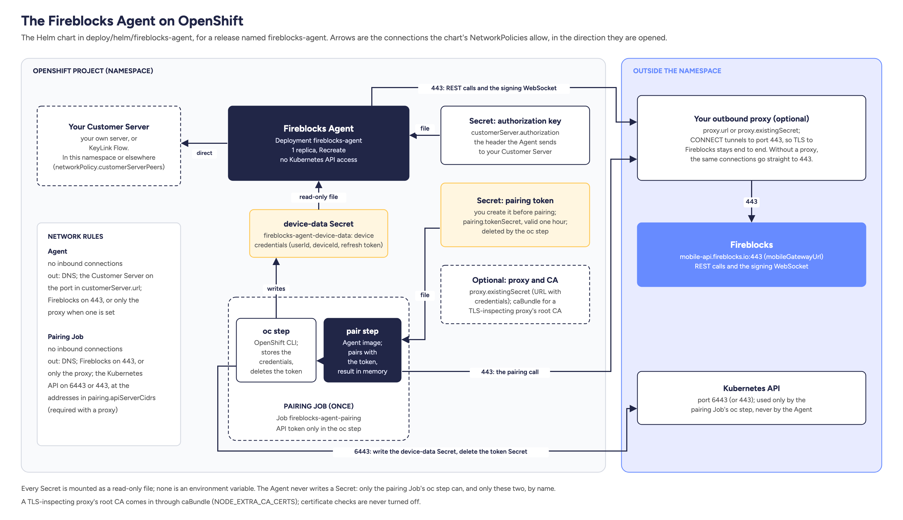
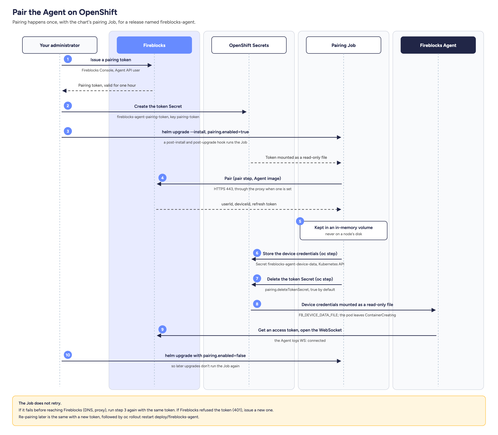

# Fireblocks Agent Helm chart

Installs the Fireblocks Agent on Red Hat OpenShift or Kubernetes, with a one-time Job that pairs it with your Fireblocks workspace. The Agent relays signing requests between Fireblocks and your Customer Server, the server that signs them: your own, built against the [Customer Server API](../../../api/customer-server.api.yml), or KeyLink Flow.

**Status: early access.**

What it installs:

- The Agent, one replica, replaced with the `Recreate` strategy: two Agents with the same device credentials conflict, so two never run at once.
- The device-data Secret, empty, for the Agent's device credentials (`userId`, `deviceId`, `refreshToken`), which the pairing Job fills. The chart never changes its data, and uninstalling the release keeps it.
- Optionally, the pairing Job, with its own service account and Role.
- NetworkPolicies: the Agent accepts no inbound connections, and reaches only DNS, your Customer Server and Fireblocks on port 443 (or only your outbound proxy, when one is set). The pairing Job reaches only DNS, Fireblocks on port 443 (or the proxy) and the Kubernetes API (on any address, unless you list its addresses in `pairing.apiServerCidrs`, which a proxy requires).



With KeyLink Flow, follow the OpenShift deployment guide in the KeyLink Flow repository (`docs/deployment/openshift.md`), which installs both charts; see [With KeyLink Flow](#with-keylink-flow).

## Security

The pods run under OpenShift's default `restricted-v2` security context constraint. No custom constraint, privileged mode or root user is needed:

- a random user ID in group 0, `runAsNonRoot`
- a read-only root filesystem; only `/tmp` is writable
- no added capabilities, no privilege escalation, the default seccomp profile

No secret is in an environment variable. The device credentials (`FB_DEVICE_DATA_FILE`) and the Authorization header for your Customer Server (`CUSTOMER_SERVER_AUTHORIZATION_FILE`) are Secrets mounted as files. The Agent has no access to the Kubernetes API.

Encryption of etcd data at rest is required. The Agent's device credentials (`userId`, `deviceId` and `refreshToken`) live in the device-data Secret, which the chart creates and the pairing Job fills, and Kubernetes stores Secrets in etcd. Without encryption at rest they are readable in etcd and in every etcd backup. The device credentials are a bearer credential: anyone who holds them can act as your Agent. So:

- Enable encryption of etcd data on the cluster (on OpenShift, set the encryption type on the `APIServer` resource), and protect etcd backups like the credentials themselves.
- Limit who can `get` or `list` Secrets in the namespace: anyone with that access can read the device credentials.
- If your policy keeps bearer credentials out of Kubernetes Secrets altogether, this chart does not meet it yet: the device credentials have no alternative to the Secret.

On Kubernetes other than OpenShift, set `platform: kubernetes`: the pods then run as the Agent image's user (1000) and the pairing Job uses `kubectl`, with the rest of the restrictions unchanged. See [Kubernetes other than OpenShift](#kubernetes-other-than-openshift).

## Before you install

1. **A namespace** for the Agent, for example `oc new-project fireblocks-agent`. The commands below use it.
2. **The Agent image** (2.5.0 or later), built from this repository and pushed to your registry. Any OCI image builder works, for example Podman or Buildah. From the directory that holds your `fireblocks-agent` checkout:

   ```bash
   podman build -t registry.example.com/fireblocks-agent:<version> fireblocks-agent
   podman push registry.example.com/fireblocks-agent:<version>
   ```

   If your registry needs credentials, create an image pull secret in the namespace and list it in `imagePullSecrets`.
3. **The `oc` image for the pairing Job.** The default, `registry.redhat.io/openshift4/ose-cli-rhel9:v4.18` pinned by digest, needs your Red Hat pull secret, which OpenShift clusters normally have in their global pull secret. If your cluster can't pull from `registry.redhat.io`, mirror it and set `pairing.cliImage.repository`; see [Images and disconnected clusters](#images-and-disconnected-clusters).
4. **The Authorization key**, if your Customer Server checks an Authorization header: the value the Agent sends, which your server must accept. Put it alone in a file and create a Secret:

   ```bash
   openssl rand -hex 24 > customer-server-authorization
   oc -n fireblocks-agent create secret generic signing-server-agent-key --from-file=customer-server-authorization
   ```

   Configure your Customer Server with the same value, then delete the file.
5. **Your Fireblocks workspace**, in the Fireblocks Console:
   - Create an API user for the Agent with the **Signer** role, under **Settings** > **Users**. Your workspace's admin quorum approves it on the Fireblocks mobile app.
   - While the user is pending pairing, its pairing token is available in the Fireblocks Console. It is valid for one hour, so issue it right before you pair.
   - After pairing, register your validation key and signing keys with Fireblocks, with this API user as the signing keys' agent.
   - Write the transaction policy rules that allow the transactions you sign, with this API user as the designated signer. A transaction that no rule allows never reaches the Agent.

   See [Workspace setup flows](../../../README.md#workspace-setup-flows) for diagrams of these steps.

## Install and pair

A minimal `agent-values.yaml`:

```yaml
image:
  repository: registry.example.com/fireblocks-agent
  tag: "<version>"
customerServer:
  url: https://signing-server:8443/api
  authorization:
    existingSecret: signing-server-agent-key
    key: customer-server-authorization
networkPolicy:
  customerServerPeers:
    - podSelector:
        matchLabels:
          app: signing-server
```

Behind a proxy, add the `proxy` block before you pair, or pairing fails; see [Outbound proxy](#outbound-proxy).



1. Issue a pairing token for the Agent API user in the Fireblocks Console. It is valid for one hour.
2. Save the token, alone, to a file named `pairing-token`, and create the Secret:

   ```bash
   oc -n fireblocks-agent create secret generic fireblocks-agent-pairing-token --from-file=pairing-token
   rm pairing-token
   ```

3. Install with pairing on:

   ```bash
   helm upgrade --install fireblocks-agent fireblocks-agent/deploy/helm/fireblocks-agent -n fireblocks-agent -f agent-values.yaml \
     --set pairing.enabled=true --set pairing.tokenSecret=fireblocks-agent-pairing-token
   ```

   Helm waits for the pairing Job and reports a failure if pairing fails. Until the Job has paired, the Agent waits in `ContainerCreating`, because the device-data Secret is still empty. So don't add `--wait` or `--atomic` to this command: they wait for the Agent to be ready before the pairing Job runs, which never happens. Check the Job:

   ```bash
   oc -n fireblocks-agent logs job/fireblocks-agent-pairing -c pair
   oc -n fireblocks-agent logs job/fireblocks-agent-pairing -c store
   ```

   Expected: `Paired: userId <id>, deviceId <id>; device data written to /scratch/device-data`, then `device credentials stored in Secret fireblocks-agent-device-data` and `pairing token Secret fireblocks-agent-pairing-token deleted`.

4. Switch pairing off, so later upgrades don't run the Job again:

   ```bash
   helm upgrade fireblocks-agent fireblocks-agent/deploy/helm/fireblocks-agent -n fireblocks-agent -f agent-values.yaml
   ```

5. Check the Agent:

   ```bash
   oc -n fireblocks-agent logs deploy/fireblocks-agent | grep -E 'Fireblocks URL|Customer server URL|WS: connected|statuses from Customer server'
   ```

   Expected: `Fireblocks URL: https://mobile-api.fireblocks.io, direct (no proxy)` (or `through the proxy ...`), `Customer server URL: <your customerServer.url>`, `WS: connected - MAG will push messages (no polling)`, and `Got 0 statuses from Customer server`, repeated, which shows the Agent reaches your server.

How the pairing Job works: it runs the Agent image in pairing mode, which writes the credentials to a memory-backed volume, and an OpenShift CLI container copies them into the device-data Secret and deletes the pairing-token Secret. With `kubectl` (`pairing.cli`, the default with `platform: kubernetes`), the pairing step also writes the Secret's data as a patch to the same volume, and two `kubectl` containers run one after the other: `store` patches the device-data Secret (`secret/<name> patched`), then `delete-token` deletes the pairing-token Secret, so the token goes only once the credentials are stored. The Job's service account may only read and update the device-data Secret and delete the pairing-token Secret, whichever tool is used, and its API token is mounted only into the `oc` or `kubectl` containers, not into the pairing step. The Job does not retry, and stops after 4 minutes, before Helm stops waiting for it (5 minutes by default).

With a GitOps tool such as Argo CD, pair with the Helm command line first. Argo CD runs Helm's post-install hooks after the other resources are healthy, and the Agent can't be healthy before it is paired, so the pairing Job would never run. Once the device-data Secret is filled, let the GitOps tool take over the release with `pairing.enabled: false`.

If pairing fails before it reaches Fireblocks (a DNS or proxy error), the token is unused: run step 3 again with the same token. If Fireblocks refused the token (`401`), issue a new one and repeat from step 1.

## Your Customer Server

`customerServer.url` is the API the Agent calls. The chart takes the port for the Agent's NetworkPolicy from the URL (`443` for `https` and `80` for `http` when the URL has none), and `networkPolicy.customerServerPeers` lists where the server runs, as NetworkPolicy peers; empty allows that port to any pod in the namespace. A NetworkPolicy matches the server pod's container port, not the Service port: if the server's Service maps a different port (for example 443 to 8443), set `networkPolicy.customerServerPort` to the container port (`8443`).

In the same namespace, select the server's pods, as in the minimal values above. In another namespace, add a `namespaceSelector`, and use the Service's full name:

```yaml
customerServer:
  url: https://signing-server.signing.svc:8443/api
networkPolicy:
  customerServerPeers:
    - namespaceSelector:
        matchLabels:
          kubernetes.io/metadata.name: signing
      podSelector:
        matchLabels:
          app: signing-server
```

Outside the cluster, give its addresses:

```yaml
customerServer:
  url: https://signing.example.com:8443/api
  ca:
    configMap: signing-server-ca
networkPolicy:
  customerServerPeers:
    - ipBlock:
        cidr: 192.0.2.20/32
```

The URL must be `https://`, with a host name the server's certificate covers; the chart refuses to render any other URL, and accepts `http://` only with `customerServer.allowInsecureHttp=true`, for a development cluster only (the scheme is compared without regard to case). For a certificate from a private CA, give the CA certificate in a ConfigMap or a Secret with `customerServer.ca` (key `ca.crt` by default), never a Secret that also holds a private key. The Agent trusts it in addition to the default CA certificates (`CUSTOMER_SERVER_CA_FILE`), only for calls to the server, and stops at startup if it can't read it. The Agent pod waits until the CA certificate exists. On OpenShift, without `customerServer.ca`, the Agent also trusts OpenShift's service CA (`customerServer.trustServiceCa`, on by default): the chart creates a ConfigMap OpenShift injects it into. Calls to your Customer Server never go through the proxy.

Your Customer Server's own NetworkPolicy must admit the Agent's pods. They carry `app.kubernetes.io/name: fireblocks-agent` and `app.kubernetes.io/component: agent`.

### With KeyLink Flow

Install the Agent in the same namespace as the KeyLink Flow chart, following the OpenShift deployment guide in the KeyLink Flow repository (`docs/deployment/openshift.md`). KeyLink Flow's server NetworkPolicy admits the Agent's pods by default, and its installation notes print the values to use. For a KeyLink Flow release named `keylink-flow` in the namespace `keylink-flow`, on OpenShift with KeyLink Flow's default TLS inside the cluster (`serviceTls.enabled`); the `ca` block is optional there, since the Agent trusts the service CA by default:

```yaml
customerServer:
  url: https://keylink-flow.keylink-flow.svc:5000/api
  authorization:
    existingSecret: keylink-flow-secrets
    key: customer-server-authorization
  ca:
    configMap: keylink-flow-service-ca
    key: service-ca.crt
networkPolicy:
  customerServerPeers:
    - podSelector:
        matchLabels:
          app.kubernetes.io/name: keylink-flow
          app.kubernetes.io/instance: keylink-flow
          app.kubernetes.io/component: customer-server
```

On other Kubernetes, KeyLink Flow serves its certificate from `tls.existingSecret`: keep the same URL and set `customerServer.ca` to a ConfigMap holding the CA certificate that issued it (see KeyLink Flow's `docs/deployment/kubernetes.md`).

## Values

`values.schema.json` checks the type of each value, and refuses names the chart doesn't know (a misspelt value would otherwise be ignored without a word). Free-form values, such as `resources`, `extraEnv`, `customerServerPeers` and the security contexts, are passed through as given.

| Value | Default | Description |
|-------|---------|-------------|
| `platform` | `openshift` | `openshift`, where restricted-v2 assigns the user ID, or `kubernetes` for any other distribution. See [Kubernetes other than OpenShift](#kubernetes-other-than-openshift). |
| `kubernetes.podSecurityContext` | `runAsUser: 1000`, `runAsGroup: 1000`, `fsGroup: 1000` | Added to `podSecurityContext` with `platform: kubernetes`. A key set in `podSecurityContext` wins. |
| `image.repository`, `image.tag` | none | Your Agent image. Required (the tag may be left empty when `image.digest` is set). |
| `image.digest` | none | `sha256:...` digest of your Agent image. Takes precedence over the tag. Recommended in production. |
| `image.pullPolicy`, `imagePullSecrets` | `IfNotPresent`, none | Pull settings. |
| `mobileGatewayUrl` | the image's `.env.prod` | Fireblocks Mobile API Gateway. |
| `customerServer.url` | none | Your Customer Server's API, `https://`. Required. |
| `customerServer.allowInsecureHttp` | `false` | Allows an `http://` URL (`ALLOW_INSECURE_CUSTOMER_SERVER`), for a development cluster only. |
| `customerServer.trustServiceCa` | `true` | On OpenShift, with an `https://` URL and no `customerServer.ca`: also trust OpenShift's service CA, from a ConfigMap the chart creates. |
| `customerServer.authorization.existingSecret`, `.key` | none, `customer-server-authorization` | Secret and key holding the Authorization header the Agent sends. Empty sends none. |
| `customerServer.ca.configMap` or `.secret`, `.key` | none, `ca.crt` | CA certificate for a server with a private CA, trusted in addition to the default ones (`CUSTOMER_SERVER_CA_FILE`). |
| `deviceData.secretName`, `deviceData.key` | `<release>-fireblocks-agent-device-data`, `device-data` | The device-data Secret. With a release name that contains `fireblocks-agent`, the default is `<release>-device-data`. |
| `pairing.enabled` | `false` | Runs the pairing Job after install or upgrade. |
| `pairing.tokenSecret`, `pairing.tokenKey` | none, `pairing-token` | The Secret holding the pairing token. |
| `pairing.deleteTokenSecret` | `true` | Deletes the pairing-token Secret after a successful pairing. |
| `pairing.apiServerCidrs` | any address | The Kubernetes API server's endpoint addresses (`kubectl get endpoints kubernetes -n default`), to narrow the pairing Job's access to the API (ports 6443 and 443). Required with a proxy or `networkPolicy.fireblocksCidrs`. |
| `pairing.cli` | `oc` on OpenShift, `kubectl` elsewhere | The tool that writes the device-data Secret and deletes the pairing-token Secret: `oc` or `kubectl`. |
| `pairing.cliImage.*` | `registry.redhat.io/openshift4/ose-cli-rhel9`, `v4.18`, pinned by digest, `IfNotPresent` | Image with `oc`, for `pairing.cli=oc`. `digest` (`sha256:...`) takes precedence over `tag`; when you change the tag, change the digest too, or set it to `""`. |
| `pairing.kubectlImage.*` | `registry.k8s.io/kubectl`, `v1.35.9`, pinned by digest, `IfNotPresent` | Image with `kubectl` on its `PATH`, for `pairing.cli=kubectl`. The default is the Kubernetes project's own image, which holds `kubectl` alone, without a shell; the chart runs `kubectl` directly. |
| `networkPolicy.enabled` | `true` | The Agent's and the pairing Job's NetworkPolicies. |
| `networkPolicy.customerServerPeers` | any pod in the namespace | Where the Customer Server runs, as NetworkPolicy peers. |
| `networkPolicy.customerServerPort` | the port in `customerServer.url` | The Customer Server pod's container port (the Service's `targetPort`), for the Agent's NetworkPolicy. Set it when the Service port differs. |
| `networkPolicy.fireblocksCidrs` | any address | Narrows the outbound port 443 to Fireblocks. Not used with a proxy. |
| `proxy.url` or `proxy.existingSecret`, `proxy.secretKey` | none, `proxy-url` | Outbound proxy for the connections to Fireblocks. A URL with credentials goes in a Secret. See [Outbound proxy](#outbound-proxy). |
| `proxy.cidrs`, `proxy.port` | none, the port in `proxy.url` | The proxy's addresses and port, for the NetworkPolicies. With `existingSecret`, set `port`. |
| `proxy.noProxy` | none | Extra hosts that go direct, added to `localhost,127.0.0.1,.svc,.cluster.local`. |
| `caBundle.configMap` or `caBundle.secret`, `caBundle.key` | none, `ca-bundle.crt` | Extra CA certificates to trust, for example a TLS-inspecting proxy's root CA (`NODE_EXTRA_CA_CERTS`). |
| `extraEnv` | none | Extra environment variables (no secrets). |
| `livenessProbe.enabled` | `true` | Restarts the Agent when its connection loop to Fireblocks stops. The Agent writes the time to a heartbeat file in `/tmp` (`HEARTBEAT_FILE`) at each connection attempt and each answered keep-alive ping, and the probe fails when the time is older than `maxAgeSeconds`. An outage at Fireblocks or at your proxy does not restart it: failing connection attempts still count. |
| `livenessProbe.maxAgeSeconds`, `.initialDelaySeconds`, `.periodSeconds`, `.timeoutSeconds`, `.failureThreshold` | `300`, `60`, `60`, `10`, `3` | Probe timings. With the defaults, a stopped loop is restarted 7 to 8 minutes after its last heartbeat. Keep `maxAgeSeconds` well above `WS_PING_INTERVAL_MS` and `FB_LONG_POLL_TIMEOUT_MS` if you raise them in `extraEnv`. |
| `resources`, `helperResources` | small limits | Resources for the Agent and the pairing step, and for the pairing Job's `oc` or `kubectl` steps. |
| `podSecurityContext`, `containerSecurityContext` | restricted-v2 compatible | Leave `runAsUser` unset on OpenShift. With `platform: kubernetes`, `podSecurityContext` is added on top of `kubernetes.podSecurityContext`. |
| `nodeSelector`, `tolerations`, `affinity` | none | Scheduling. |

## Outbound proxy

When the cluster reaches the internet only through a proxy, set `proxy.url` (for example `http://proxy.example.com:3128`), or `proxy.existingSecret` with the key `proxy.secretKey` when the URL carries a user name and password. Never put credentials in a values file: from a Secret, the URL is mounted as a file and read through `HTTPS_PROXY_FILE`, not set as an environment variable.

1. For a URL with credentials, put the URL alone in a file named `proxy-url`, with the user name and password before the host name as `user:password@` (percent-encode special characters), and create the Secret:

   ```bash
   oc -n fireblocks-agent create secret generic outbound-proxy --from-file=proxy-url
   rm proxy-url
   ```

2. For a proxy that inspects TLS, put its root CA certificate in a ConfigMap:

   ```bash
   oc -n fireblocks-agent create configmap outbound-proxy-ca --from-file=ca-bundle.crt=./proxy-root-ca.pem
   ```

3. Add to `agent-values.yaml`:

   ```yaml
   proxy:
     url: http://proxy.example.com:3128
     # or, with credentials: existingSecret: outbound-proxy, and port: 3128
     cidrs: ["192.0.2.10/32"]
   pairing:
     # The Kubernetes API server's endpoint addresses: oc get endpoints kubernetes -n default
     apiServerCidrs: ["198.51.100.10/32"]
   # Only for a proxy that inspects TLS.
   caBundle:
     configMap: outbound-proxy-ca
   ```

What it does:

- All the Agent's connections to Fireblocks go through the proxy: the REST calls, the signing WebSocket, and the pairing step of the pairing Job. Each is a `CONNECT` tunnel, so TLS to Fireblocks stays end to end.
- Allow `CONNECT` to `mobile-api.fireblocks.io` port 443 (the host in `mobileGatewayUrl`) and keep the tunnel open: the signing WebSocket runs inside it for as long as the Agent is connected, so a short idle timeout on the proxy causes reconnects. A proxy that inspects TLS must pass WebSocket upgrades through.
- Never through the proxy: the Agent's calls to your Customer Server, and the pairing Job's `oc` step, which talks to the Kubernetes API. `NO_PROXY` is `localhost,127.0.0.1,.svc,.cluster.local` plus `proxy.noProxy`.
- The NetworkPolicies then allow the Agent and the pairing Job to reach `proxy.cidrs` on the proxy's port, instead of port 443 on any address. List the proxy's addresses: NetworkPolicies take addresses, not host names.
- The pairing Job also reaches the Kubernetes API, on ports 6443 and 443. With a proxy the chart requires `pairing.apiServerCidrs`, so that this rule doesn't open port 443 to any address: list the addresses from `oc get endpoints kubernetes -n default`, not the `kubernetes` Service's IP, because NetworkPolicies see the endpoint the Service forwards to.
- `caBundle` adds the proxy's root CA to the certificates the Agent trusts, through Node's `NODE_EXTRA_CA_CERTS`. Certificate checks are never turned off.
- A proxy that inspects TLS can read the Agent's traffic with Fireblocks, including its access tokens. If your policy allows, let `mobile-api.fireblocks.io` pass as a plain `CONNECT` tunnel without inspection. With credentials in the proxy URL, prefer an `https://` proxy URL, so they don't cross the network in clear text.

The Agent's startup log shows the route, without credentials: `Fireblocks URL: https://mobile-api.fireblocks.io, through the proxy http://proxy.example.com:3128`.

## Operations

- **Upgrade:** `helm upgrade` with `pairing.enabled` left at `false`. The device-data Secret has no data in the chart, so an upgrade never resets it. The Agent briefly stops, then reconnects. With `pairing.enabled` left on, the pairing Job finds that its token Secret is gone (the last successful pairing deleted it) and fails at once, which fails the upgrade (or the sync, with Argo CD); see [Troubleshooting](#troubleshooting).
- **Rotate the Authorization key:** have your Customer Server accept the new key alongside the old one, update the key in the Secret named by `customerServer.authorization.existingSecret`, restart the Agent with `oc -n fireblocks-agent rollout restart deploy/fireblocks-agent`, then remove the old key from your server.
- **Rotate the proxy credentials:** update the proxy Secret, then restart the Agent.
- **Re-pairing:** when the Agent API user is paired to another device, or the device credentials are lost, issue a new pairing token for the user and repeat [Install and pair](#install-and-pair) from step 1, then restart the Agent.
- **Back up and restore:** to restore the Agent without pairing again, export the device-data Secret into your secret manager, never into a file on disk. To restore it, recreate the Secret with the same name and key from your secret manager, then restart the Agent.
- **Uninstall:** `helm uninstall fireblocks-agent -n fireblocks-agent` keeps the device-data Secret, so a reinstall finds it. Delete it by hand to remove the Agent's credentials.

## Troubleshooting

**The pairing Job fails with `getaddrinfo EAI_AGAIN`, a proxy error, or `DeadlineExceeded`.** Pairing did not reach Fireblocks (the Job stops after 4 minutes, `activeDeadlineSeconds: 240`). Check DNS, the NetworkPolicies and, behind a proxy, that the proxy allows `CONNECT mobile-api.fireblocks.io:443`. The token is unused: run step 3 again with the same token.

**The pairing Job fails at once, and `oc logs job/fireblocks-agent-pairing -c pair` shows `The pairing token Secret ... does not exist or is empty`.** The Secret named by `pairing.tokenSecret` is missing or holds no `pairing.tokenKey`. Nothing was sent to Fireblocks. Usually `pairing.enabled` was left on after a successful pairing, which deleted the Secret: if the Agent is paired, upgrade again with `pairing.enabled=false`. To pair or re-pair, create the Secret with a fresh token first.

**The pairing Job fails with `Pairing failed: Request failed with status code 401`.** Fireblocks refused the token: it has expired, was already used, or belongs to another user or workspace. Issue a new token and pair again.

**The pairing Job fails with `PAIRING_TOKEN_FILE ... does not hold a pairing token in JWT format`.** The Secret holds something other than the token alone. Recreate it from a file holding only the token.

**The pairing Job's `store` step can't write the Secret (`dial tcp ... i/o timeout`).** Its NetworkPolicy doesn't allow the Kubernetes API's address: `pairing.apiServerCidrs` must list the endpoint addresses from `oc get endpoints kubernetes -n default`.

**The pairing Job's `store` step shows `ImagePullBackOff`.** The cluster can't pull the `oc` image. Add your Red Hat pull secret, or mirror the image and set `pairing.cliImage.repository` (keep the digest); see [Images and disconnected clusters](#images-and-disconnected-clusters).

**The Agent restarts and `oc describe pod` shows `Liveness probe failed`.** The Agent's connection loop to Fireblocks wrote no heartbeat for `livenessProbe.maxAgeSeconds`. Look in the log of the previous container (`oc logs deploy/fireblocks-agent --previous`) for the last `WS:` lines, and report repeated restarts to Fireblocks support with that log. If you raised `WS_PING_INTERVAL_MS` or `FB_LONG_POLL_TIMEOUT_MS`, raise `maxAgeSeconds` above them. `livenessProbe.enabled=false` turns the probe off.

**The Agent stays in `ContainerCreating`.** The device-data Secret is empty: `oc -n fireblocks-agent describe pod -l app.kubernetes.io/component=agent` shows `references non-existent secret key: device-data`. Pair the Agent. With `customerServer.ca`, it also waits until the CA ConfigMap or Secret exists.

**The Agent logs `connect ETIMEDOUT` or other errors when it calls your Customer Server.** Check that `networkPolicy.customerServerPeers` selects the server, that the server's own NetworkPolicy admits the Agent's pods, and that `customerServer.url` uses the host name the server's certificate covers.

**Behind the proxy, the Agent logs `Request failed with status code 407`, or `WS: connect failed` right after connecting.** The proxy refused the tunnel: check the credentials in the proxy URL, and that the proxy allows `CONNECT` to `mobile-api.fireblocks.io:443`. If `WS: connected` is followed by regular disconnects, raise the proxy's idle timeout for that host.

**Behind the proxy, the Agent logs `unable to verify the first certificate` or `self-signed certificate in certificate chain`.** The proxy inspects TLS and its root CA is not trusted: set `caBundle` to a ConfigMap or Secret holding it.

## Images and disconnected clusters

The cluster pulls two images: your Agent image (pin it with `image.digest`), and, for pairing, the `oc` image, `registry.redhat.io/openshift4/ose-cli-rhel9:v4.18`, which the chart pins by digest (`pairing.cliImage.digest`), or with `pairing.cli=kubectl` the `kubectl` image, `registry.k8s.io/kubectl:v1.35.9`, also pinned by digest (`pairing.kubectlImage.digest`). A tag can be re-pushed, a digest can't, so pin both in production. `registry.k8s.io` needs no authentication; to mirror its image, follow the steps below with `pairing.kubectlImage.repository`.

`registry.redhat.io` needs authentication. OpenShift clusters normally have it in their global pull secret (`pull-secret` in the `openshift-config` namespace), which the pairing Job uses without any setting. Otherwise, create a pull secret from your Red Hat account in the namespace and list it in `imagePullSecrets`, which the Agent and the pairing Job both use.

On a disconnected (air-gapped) cluster:

1. Mirror the `oc` image into a registry the cluster can reach, with all its architectures so the digest stays the same, for example `oc image mirror registry.redhat.io/openshift4/ose-cli-rhel9@sha256:<digest> registry.example.com/mirror/openshift4/ose-cli-rhel9` or `skopeo copy --all`. Clusters mirrored with `oc-mirror` may already hold it.
2. Set `pairing.cliImage.repository` to the mirror and keep `pairing.cliImage.digest`.
3. If the mirror needs credentials, list its pull secret in `imagePullSecrets`.

Alternatively, an `ImageDigestMirrorSet` (OpenShift 4.13 and later) makes the cluster pull `registry.redhat.io` digest references from your mirror without changing the values. It applies to digest references only, which is another reason to pin by digest.

## Kubernetes other than OpenShift

Set `platform: kubernetes`, for example on Google Kubernetes Engine (GKE). `ci/gke-values.yaml` is an example.

- **User and group IDs.** OpenShift assigns each pod a user ID through its security context constraint; plain Kubernetes doesn't. With `platform: kubernetes` the chart runs every pod as user and group 1000, the Agent image's own user, with `fsGroup: 1000`, so the pods pass `runAsNonRoot` and can read the mounted Secrets. The `kubectl` image runs as root by default, so the pairing Job needs this too. Change them in `kubernetes.podSecurityContext`, or override single keys in `podSecurityContext`. The chart refuses to render without a non-zero `runAsUser` and `runAsNonRoot`.
- **The pairing step.** It writes the Secret with `kubectl` from `registry.k8s.io`, which needs no pull secret, instead of `oc` from Red Hat's registry (`pairing.cli`). The Role is the same: read and update the device-data Secret, delete the pairing-token Secret.
- **The Kubernetes API's address.** On managed clusters the API server is outside the cluster's network, often on port 443, for example GKE's control plane endpoint. List the address from `kubectl get endpoints kubernetes -n default` in `pairing.apiServerCidrs`.
- **NetworkPolicies.** The DNS rule opens port 53 only (OpenShift's DNS also listens on 5353). They need a network plugin that enforces NetworkPolicies, such as GKE Dataplane V2 or Calico.
- **Your server's CA.** There is no OpenShift service CA. For a Customer Server with a certificate from your own CA, for example KeyLink Flow with a cert-manager certificate, give that CA with `customerServer.ca`. The URL stays `https://`.
- **Commands.** Where this README uses `oc`, use `kubectl`.

An Agent outside the cluster, for example on Cloud Run, uses the Agent image without this chart: it reaches KeyLink Flow through KeyLink Flow's internal load balancer (`loadBalancer` in the KeyLink Flow chart), and its device credentials come from your secret manager through `FB_DEVICE_DATA`.

## Check the chart

```sh
sh deploy/helm/fireblocks-agent/test/render.sh
```

It runs `helm lint --strict` and `helm template | kubeconform -strict` for every file in `ci/`, then checks that each of the chart's render guards and `values.schema.json` still refuse the values they are meant to refuse, with their messages, that the liveness probe and the pairing Job's token check render, that `platform: kubernetes` sets the user ID and switches the pairing Job to `kubectl` with the token deleted after the Secret is stored, and that the Customer Server and proxy ports reach the NetworkPolicies (IPv6 addresses included). It needs `helm` and `kubeconform`. CI runs it. In `ci/`, `keylink-flow-values.yaml` covers the Agent next to KeyLink Flow, `pairing-values.yaml` a Customer Server over plain HTTP during pairing, with narrowed egress, `proxy-values.yaml` an outbound proxy, and `gke-values.yaml` Google Kubernetes Engine with pairing through `kubectl`.
